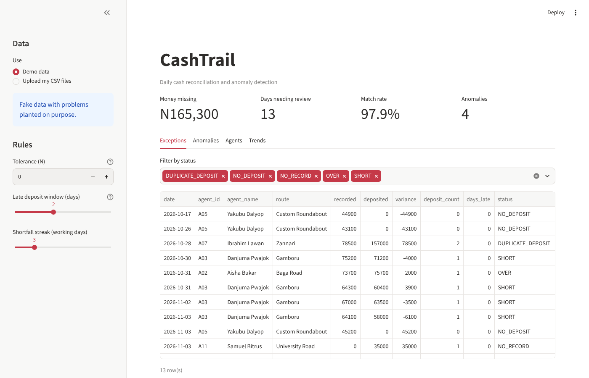
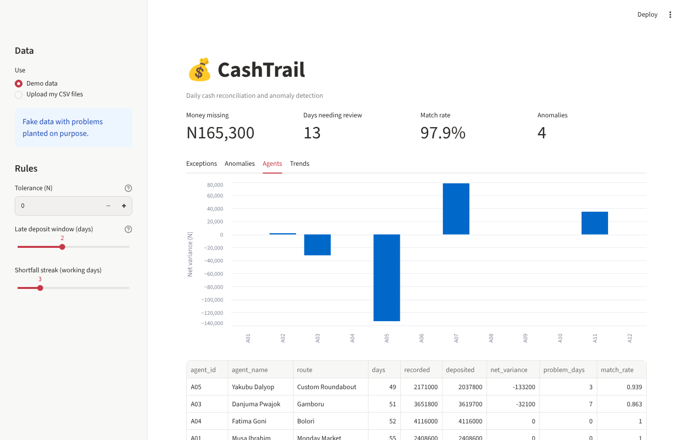

# CashTrail

**Find the gaps between cash collected and cash deposited.**

CashTrail is a cash reconciliation and anomaly detection tool for businesses that collect money through field agents. It compares collection records with bank deposits, highlights discrepancies and helps teams spot unusual collection patterns through an interactive dashboard and downloadable Excel reports.

<p align="center">
  
</p>

<p align="center">
  
</p>

<p align="center">
  
  
  
  
</p>

## What it does

CashTrail takes two CSV files: one containing money recorded as collected by agents and another containing their deposits. It matches the records by agent and date, calculates the difference and flags transactions that may need attention.

It also looks beyond individual transactions to identify repeated shortfalls and sudden drops in an agent's collections compared with their own recent history.

## Features

- **Cash reconciliation:** Compare recorded collections with deposited amounts by agent and date.
- **Exception detection:** Flag short deposits, excess deposits, missing deposits, deposits without collection records and duplicate deposits.
- **Late deposit matching:** Match eligible deposits received within a configurable grace period.
- **Anomaly detection:** Identify consecutive shortfall patterns and unusually low collections against an agent's previous performance.
- **Interactive dashboard:** Explore exceptions, anomalies, agent performance and collection trends.
- **Excel reports:** Export a workbook with summary, exceptions, anomalies, agent scorecard and reconciliation records.
- **Demo data:** Generate sample records with deliberately introduced issues so the application can be explored without real financial data.

## Run it locally

### 1. Clone the repository

```bash
git clone https://github.com/Kuulbudam/cashtrail.git
cd cashtrail
```

### 2. Create and activate a virtual environment

**Windows**

```bash
python -m venv .venv
.venv\Scripts\activate
```

**macOS / Linux**

```bash
python -m venv .venv
source .venv/bin/activate
```

### 3. Install dependencies

```bash
pip install -r requirements.txt
```

### 4. Start CashTrail

Launch the interactive dashboard:

```bash
streamlit run app.py
```

Or run the command-line demo:

```bash
python -m cashtrail demo
```

The demo generates sample CSV files in `data/` and saves its Excel report and text summary in `reports/`.

## Use your own CSV files

CashTrail expects two files.

**Collections CSV**

| Column | Description |
|---|---|
| `date` | Date the cash was collected |
| `agent_id` | Agent identifier |
| `agent_name` | Agent name |
| `route` | Assigned route or collection area |
| `amount` | Amount collected |

Example:

```csv
date,agent_id,agent_name,route,amount
2026-01-01,A01,John Doe,Market Road,80000
2026-01-01,A02,Jane Doe,Main Street,65000
```

**Deposits CSV**

| Column | Description |
|---|---|
| `date` | Date the deposit was recorded |
| `agent_id` | Agent identifier |
| `amount` | Amount deposited |
| `reference` | Deposit reference |

Example:

```csv
date,agent_id,amount,reference
2026-01-01,A01,80000,TRF1001
2026-01-01,A02,60000,TRF1002
```

You can upload both files in the dashboard or run reconciliation from the terminal:

```bash
python -m cashtrail run --collections collections.csv --deposits deposits.csv --tolerance 100 --grace-days 2
```

- `--tolerance` sets the permitted difference in the same currency units as the input data.
- `--grace-days` sets how many days after collection a deposit can arrive and still be matched.
- `--out` changes the report output directory. It defaults to `reports/`.

## What the results mean

| Result | Meaning |
|---|---|
| `MATCHED` | Recorded and deposited amounts agree within the tolerance. |
| `LATE_DEPOSIT` | A deposit was matched to an earlier collection within the grace period. |
| `SHORT` | The deposited amount is below the recorded amount. |
| `OVER` | The deposited amount is above the recorded amount. |
| `NO_DEPOSIT` | A collection has no matching deposit. |
| `NO_RECORD` | A deposit has no matching collection record. |
| `DUPLICATE_DEPOSIT` | The same agent, date and amount appear more than once in the deposit records. |

The anomaly view can also report `SHORTFALL_STREAK` and `SUDDEN_DROP`. These are signals for review, not proof of fraud or misconduct.

## Project structure

```text
cashtrail/
├── cashtrail/
│   ├── anomalies.py    # Shortfall and collection-drop detection
│   ├── cli.py          # Command-line interface
│   ├── generate.py     # Synthetic demo data
│   ├── reconcile.py    # Data cleaning and reconciliation
│   └── report.py       # Excel and text reports
├── docs/               # Dashboard screenshots
├── tests/              # Automated tests
├── app.py              # Streamlit dashboard
└── requirements.txt
```

## Run the tests

```bash
python -m pytest -q
```

The tests cover reconciliation statuses, tolerance handling, late deposits, shortfall streaks, sudden collection drops and dashboard startup.

## Built with

Python · Pandas · NumPy · Streamlit · OpenPyXL · Pytest · GitHub Actions

## Notes

- The included demonstration data is synthetic. It contains intentionally introduced discrepancies for testing and demonstration.
- CashTrail currently reads CSV files; it does not connect directly to a bank or financial database.
- A single deposit covering multiple collection days is not automatically split across those days.
- Anomaly flags should be reviewed in context before any financial or operational decision is made.

---

**CashTrail** · A Python project exploring financial reconciliation, data analysis and anomaly detection.